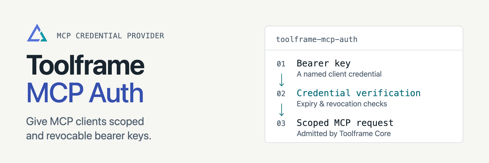

<p align="center">
<picture>
  <source media="(prefers-color-scheme: dark)" srcset="docs/assets/readme-banner-dark.png">
  <source media="(prefers-color-scheme: light)" srcset="docs/assets/readme-banner-light.png">
  
</picture>
</p>

# Toolframe MCP Auth

[](https://github.com/toolframe/toolframe-mcp-auth/actions/workflows/ci.yml?query=branch%3Amain)

Issue named, revocable bearer keys for Toolframe MCP clients.
Each key grants explicit business scopes; only its digest is stored.

## Quick start

Use Python 3.14+, SDK 0.4+, a SQL provider and FastMCP in a running Toolframe app.
Add these settings to `APP/toolframe.toml`, preserving the existing composition:

```toml
[mcp_access]
mode = "protected"
auth_provider = "mcp-auth"

[plugins.mcp-auth]
source = "pypi:toolframe-mcp-auth==0.3.2"
enabled = true
```

```sh
toolframe --home APP apply
```

Create a key through Dashboard Auth's **MCP keys** page or Core's protected API.
Clients send `Authorization: Bearer <key>` with every request to `/mcp`.

**Access:** protected MCP stays closed when the provider is unavailable. Local
clients also need credentials; remote connections require HTTPS. Secrets are
shown once. Creating a key does not change the independent Dashboard policy.

## Guides

| I want to… | Start here |
| --- | --- |
| Issue, rotate or revoke keys | [Authentication](docs/authentication.md) |
| Configure clients and access | [Core MCP guide](https://github.com/toolframe/toolframe-core/blob/main/docs/mcp-authentication.md) |
| Use browser-based agent consent | [OIDC Auth](https://github.com/toolframe/toolframe-oidc-auth) |
| Contribute or run checks | [Contributing](CONTRIBUTING.md) |
| Publish a package | [Releasing](docs/releasing.md) |

[Releases](https://github.com/toolframe/toolframe-mcp-auth/releases)

## License

[Apache 2.0](LICENSE), with [NOTICE](NOTICE).
